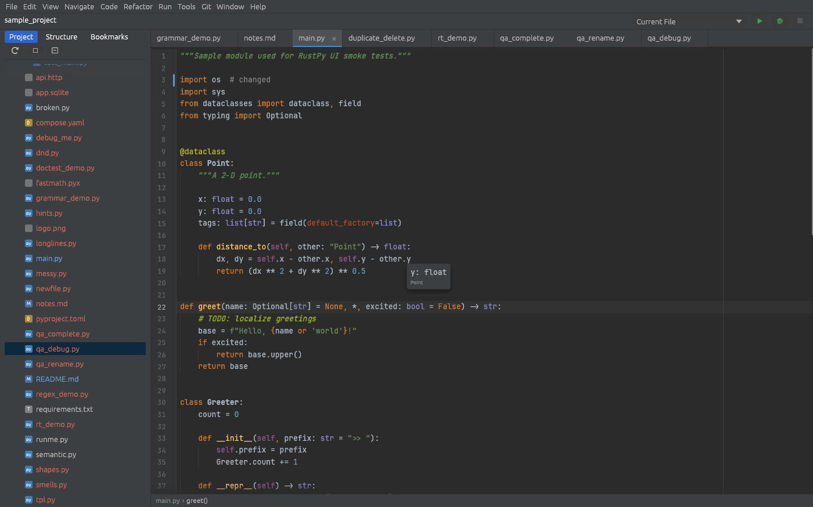
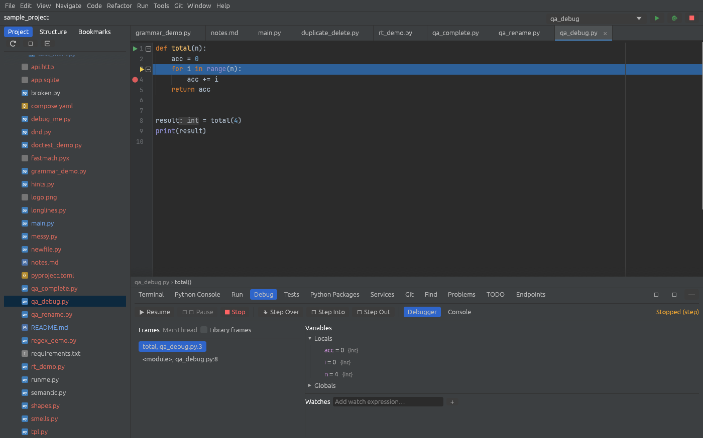
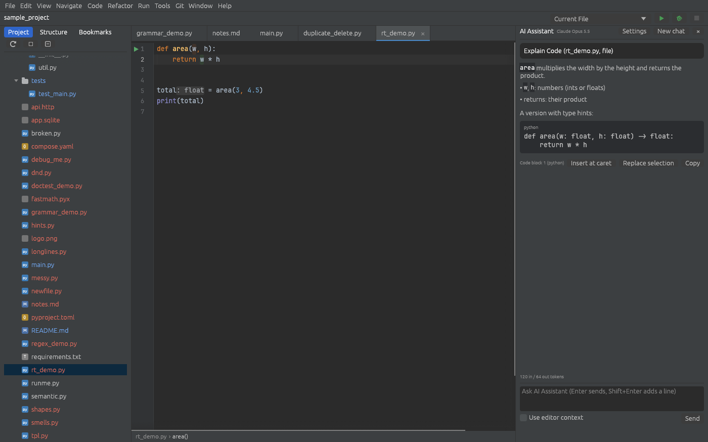

# RustPy

RustPy is a full-featured Python IDE written from scratch in Rust, with an
[egui](https://github.com/emilk/egui) user interface. It has its own lossless Python parser
and type inference, a debugger, test runners, Git integration, an embedded terminal, a
language server for other editors and an AI assistant, and it uses the Python interpreters
and tools already installed on your machine.

> **Status: pre-release (0.1.0, unreleased).** Most day-to-day editing, navigation,
> refactoring, run/debug, test and version-control features work, and Linux is the
> best-tested platform. Expect rough edges, especially on macOS, which has not been tested on
> real hardware yet. See [HANDOFF.md](HANDOFF.md) for the current state and
> [docs/review-backlog.md](docs/review-backlog.md) for known issues.



## Highlights

- **Editor:** multiple carets and block selection, smart keys, folding, soft wrap, sticky
  lines, inlay hints, rainbow brackets, semantic highlighting, live/postfix/surround templates,
  macros, local history, Markdown preview, image viewer.
- **Code insight:** completion (basic, smart, auto-import on second press, usage-ranked),
  parameter info, quick documentation, about 60 inspections with quick fixes, intentions,
  grammar checks, regex injection and run-time type collection, all on RustPy's own parser and
  type inference with bundled typeshed stubs.
- **Navigation and refactoring:** Search Everywhere, go to class/file/symbol/action (also over
  persistent library indexes and shared index bundles), find usages, structural search and
  replace, type/method/call hierarchies, rename, extract variable/method/constant, inline,
  change signature, move, pull up/push down, safe delete.
- **Run, debug, test:** run configurations, a debugpy-based debugger (breakpoints, frames,
  variables, watches, evaluate), pytest and unittest runners, branch coverage, a profiler, and
  a Python Console with a variables view, DataFrame viewer, Execute Selection (Alt+Shift+E) and
  `# %%` code cells.
- **Tools:** Git (commit, diff, log graph, branches, merge/rebase, stash, blame, conflicts),
  terminal, Python Packages (pip or uv) with PyPI and OSV vulnerability checks, HTTP client,
  database tools, Docker, framework endpoints (Flask, FastAPI, Django), Jinja2 and Django
  templates, remote interpreters (SSH, Docker, WSL), deployment (SFTP, rsync, FTP, local
  folders), tasks and contexts, an interactive features trainer.
- **Data science:** Jupyter notebook editor (cells, outputs, images, kernels), a table viewer
  for console variables, Gherkin `.feature` files with step navigation and behave runs.
- **Other editors:** `rustpy lsp` serves the same inspections, completion, navigation, rename
  and formatting to Neovim, Helix, VS Code or Emacs; see [docs/lsp.md](docs/lsp.md).
- **AI Assistant:** chat with editor context, AI actions (explain, refactor, write tests and
  docstrings, fix errors) and commit-message generation through the Anthropic Messages API or a
  compatible Chat Completions provider you configure in Settings › Tools › AI Assistant.
- **Network and secrets:** HTTP/SOCKS proxy settings used by every network feature (and passed
  to pip and uv), server certificate management, and a password safe (OS keyring or an
  encrypted file with an optional master password).

| Debugger | AI Assistant |
|---|---|
|  |  |

## Documentation

- [User guide and help index](docs/README.md)
- [Keymap reference](docs/keymap.md)
- [Architecture](docs/architecture.md)
- [Contributing](docs/contributing.md)
- [Roadmap and feature status](roadmap.md)
- [Changelog](CHANGELOG.md)

## Build and run

Requirements: Rust 1.95 or newer, a C toolchain (for libgit2 and SQLite) and Python 3 for
running and analysing code. On Debian or Ubuntu:

```bash
sudo apt-get install -y build-essential pkg-config libxkbcommon-dev libwayland-dev libgtk-3-dev unixodbc-dev
cargo run --release -- /path/to/python/project
```

The database backend links unixODBC even when you only use SQLite. Building needs
`unixodbc-dev` (for `libodbc.so`); running a prebuilt binary needs `libodbc2`
(`libodbc.so.2`). Database-specific ODBC drivers are only needed for ODBC connections.

Useful options: `--open-file <file>` opens a file, `--verbose` enables debug logging and
`--welcome` starts on the welcome screen. Settings, logs and per-project files are described in
[docs/configuration-directories.md](docs/configuration-directories.md); set
`RUSTPY_CONFIG_DIR` to use a separate configuration directory.

### Platform notes

- **Linux** is the primary platform (X11 and Wayland). Installers: AppImage, `.deb`, `.rpm`,
  Flatpak and Snap recipes in [packaging/README.md](packaging/README.md).
- **Windows** binaries can be cross-built from WSL; see [WINDOWS.md](WINDOWS.md). Inno Setup,
  MSI and MSIX recipes are in the packaging guide.
- **macOS**: a universal app bundle and DMG recipe exist but have not yet been tested on a Mac.
- **Language:** the UI follows the locale environment variables (`LANGUAGE`, `LC_ALL`,
  `LC_MESSAGES`, `LANG`); Windows and macOS apps usually have none of them and start in
  English. Settings › Appearance › Language picks another of the nine languages. Chinese,
  Japanese and Korean need a system CJK font such as Noto Sans CJK (`fonts-noto-cjk`).

## Development

The workspace is split into crates under [crates/](crates):

| Crate | Purpose |
|---|---|
| `rustpy` | Binary entry point and logging |
| `rustpy-ui` | The egui application: editor, tool windows, dialogs, settings |
| `rustpy-syntax` | Lossless Python lexer and parser (rowan CST) |
| `rustpy-semantic` | Scopes, module resolution, type inference, inspections, refactorings, completion |
| `rustpy-analysis`, `rustpy-refactor` | Inspections, quick fixes and intentions; extraction, inlining, move and signature refactorings |
| `rustpy-highlight`, `rustpy-textmate` | Syntax highlighters for Python and other languages, color schemes, TextMate grammars |
| `rustpy-text` | Rope-backed documents with undo/redo |
| `rustpy-format` | Black / PEP 8 style formatter |
| `rustpy-run`, `rustpy-debug`, `rustpy-test` | Run configurations and processes, debugpy (DAP) client, test runners, coverage and profiler |
| `rustpy-console`, `rustpy-terminal` | Python Console backend, embedded PTY terminal |
| `rustpy-vcs` | Git integration (libgit2) |
| `rustpy-packages`, `rustpy-http`, `rustpy-db`, `rustpy-docker` | pip/PyPI/OSV, HTTP client, SQLite tools, Docker CLI |
| `rustpy-search`, `rustpy-templates`, `rustpy-regex`, `rustpy-grammar` | Find in files, live templates, regex injection, grammar checks |
| `rustpy-index` | Persistent symbol indexes of interpreter libraries and projects, shared index bundles |
| `rustpy-ai` | AI Assistant backend (Anthropic and compatible Chat Completions, streaming) |
| `rustpy-i18n` | UI translations (Simplified Chinese, Japanese, Korean, German, French, Spanish, Brazilian Portuguese, Russian), plural rules, system locale and CJK font lookup |
| `rustpy-plugins` | Declarative plugins (Settings › Plugins): manifests, install/enable/uninstall, Marketplace catalog, contributed templates, schemes, keymaps, tools |
| `rustpy-net`, `rustpy-secrets` | HTTP proxy and certificate trust for the IDE's own HTTP(S) requests, password safe |
| `rustpy-lsp` | Language server (`rustpy lsp`) exposing the engine to other editors |
| `rustpy-project` | Project model, interpreter discovery, run configurations |
| `rustpy-notebook`, `rustpy-gherkin` | Jupyter notebooks, Gherkin `.feature` files and step definitions |
| `rustpy-deploy`, `rustpy-updates` | Deployment to remote servers, update checks against GitHub Releases |
| `rustpy-emmet`, `rustpy-spell` | Emmet abbreviations, spell checking |
| `rustpy-cli` | Command-line launcher, single-instance IPC, headless `format`/`inspect` modes |
| `rustpy-settings`, `rustpy-core` | Settings and project files, shared types |

Before opening a pull request, run:

```bash
cargo fmt --all -- --check
cargo clippy --workspace --all-targets -- -D warnings
cargo test --workspace
```

On a shared machine, limit the parallelism as described in
[docs/contributing.md](docs/contributing.md#running-checks-with-limited-cores). The full set of
quality gates is in [docs/quality.md](docs/quality.md). The same checks run in GitHub Actions
([.github/workflows/ci.yml](.github/workflows/ci.yml)) on every push to `main` and every pull
request.

### Headless UI testing

`scripts/smoke.sh` runs the IDE on a virtual X display (Xvfb) and saves a screenshot, so UI
checks never open a window on your desktop:

```bash
RUSTPY_CONFIG_DIR=$(mktemp -d) RUSTPY_SMOKE_DELAY=5 \
  scripts/smoke.sh <project-dir> --open-file main.py --input-script steps.txt --screenshot out.png
```

`--action <ActionId>` runs IDE actions and `--tool <name>` opens tool windows.
`--input-script` replays mouse and keyboard input (`click`, `dclick`, `rclick`, `drag`,
`key S ctrl`, `type text`, `paste`, `wait`); see
[crates/rustpy-ui/src/input_script.rs](crates/rustpy-ui/src/input_script.rs).

## License

RustPy's own code is licensed under [Apache-2.0](LICENSE). Third-party code, fonts, data and
other resources keep their own licences: for example, the bundled Hack editor font is under the
MIT License and the Bitstream Vera License. Redistributed artifacts include `LICENSE` and
`THIRD-PARTY-NOTICES.txt`, and release packaging checks that the notice bundle is complete; see
[the packaging guide](packaging/README.md#bundled-resource-notices).
